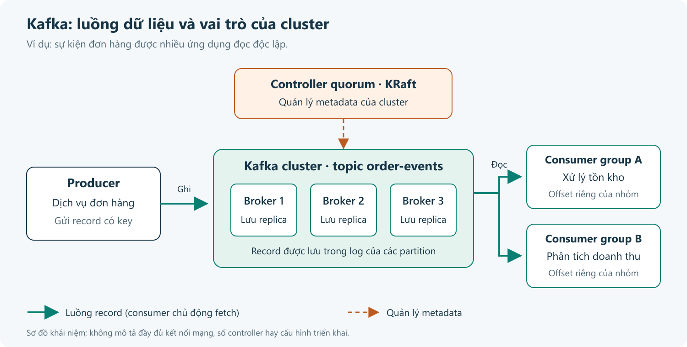
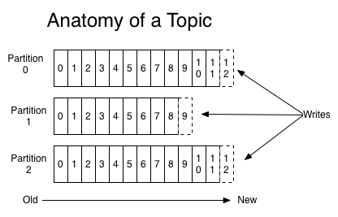
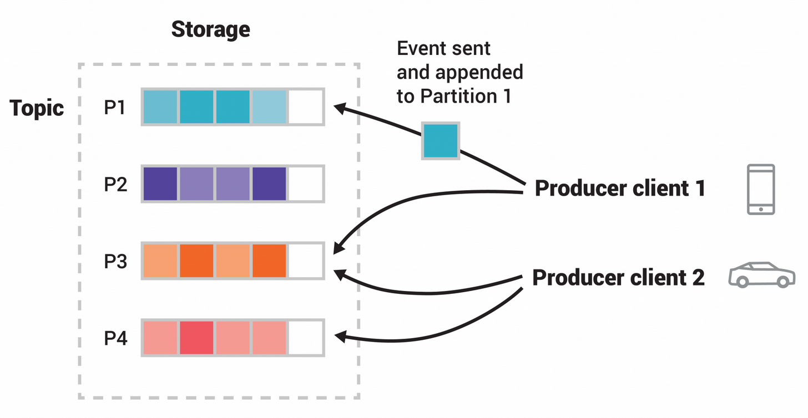
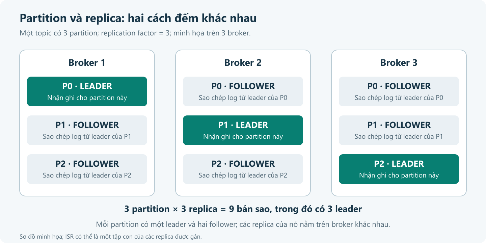
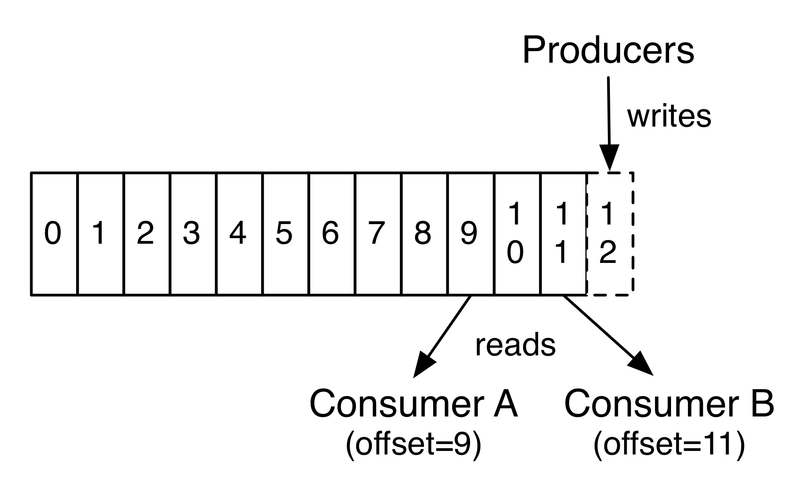
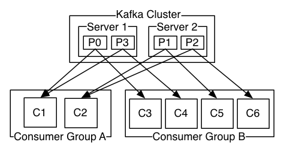

# Kiến trúc Apache Kafka


*Biểu trưng Apache Kafka. Nguồn: [Apache Kafka](https://kafka.apache.org/); sử dụng hình gốc.*

*Từ sự kiện và luồng dữ liệu đến brokers, topics, partitions, replication và offsets*

**Đối tượng:** người mới học kỹ thuật dữ liệu, đã biết cách một ứng dụng gửi và nhận dữ liệu. Bài đọc không yêu cầu kinh nghiệm vận hành Kafka hoặc lập trình Java.

**Mục tiêu:** sau bài học, bạn có thể đọc một sơ đồ Kafka; giải thích vai trò của producer, broker và consumer; phân biệt partition với replica; phân tích cách key ảnh hưởng đến phân phối record; và theo dõi tiến độ đọc bằng offset, committed offset và consumer lag.

**Ví dụ xuyên suốt:** một cửa hàng trực tuyến phát sinh sự kiện đơn hàng. Bộ phận tồn kho, thông báo và phân tích doanh thu cần sử dụng các sự kiện đó theo những cách khác nhau.

**Phần thực hành:** [Hands-on: tạo topic và quan sát message distribution](kafka-architecture-hands-on.md).

**Câu hỏi củng cố:** [Quiz trắc nghiệm](kafka-architecture-quiz.md); đáp án và giải thích nằm trong file solution riêng.

**Phạm vi:** đây là bài lý thuyết. Các bước chạy Kafka nằm trong bài hands-on; đề trắc nghiệm và lời giải là hai tài liệu độc lập.

> **Mốc tham chiếu:** bài dùng tài liệu Apache Kafka **4.1**, đối chiếu ngày 02/11/2026, để thống nhất thuật ngữ và hành vi được giải thích; đây không phải tuyên bố về phiên bản mới nhất. Phần consumer group nói về nhóm `KafkaConsumer` thông thường với cơ chế phân công partition, không bao gồm share groups. Sơ đồ và số liệu đơn hàng là ví dụ giảng giải, không phải kết quả chạy một cluster thực tế.

## 1. Bắt đầu từ một sự kiện đơn hàng

Giả sử khách hàng vừa đặt thành công đơn `o1001`. Hệ thống cần ghi nhận đơn hàng, cập nhật tồn kho, gửi thông báo và đưa dữ liệu vào báo cáo doanh thu.

Một cách triển khai là để dịch vụ đơn hàng gọi trực tiếp từng dịch vụ phía sau. Khi có thêm một ứng dụng phân tích, dịch vụ đơn hàng lại phải biết đến ứng dụng mới. Nếu một dịch vụ phản hồi chậm hoặc tạm ngừng hoạt động, nhóm phát triển còn phải quyết định chờ, thử lại hay bỏ qua công việc đó.

Một hướng khác là để dịch vụ đơn hàng công bố sự kiện: **“đơn o1001 đã được tạo”**. Các ứng dụng quan tâm tự đọc sự kiện và xử lý theo trách nhiệm của mình. Ứng dụng tồn kho có thể đọc ngay, còn ứng dụng phân tích có thể đọc chậm hơn hoặc đọc lại dữ liệu để tính lại báo cáo.

Kafka hỗ trợ mô hình này bằng cách tiếp nhận, lưu giữ và cho phép nhiều ứng dụng đọc các luồng sự kiện. Việc xử lý đơn hàng, gửi email hay tính doanh thu vẫn do mã ứng dụng thực hiện. Kafka cung cấp cơ chế vận chuyển và lưu trữ luồng dữ liệu ở giữa các ứng dụng. Xem [tổng quan Apache Kafka][kafka-intro].

Điều cần tìm hiểu tiếp theo là: sự kiện được lưu ở đâu, được chia ra thế nào, có bao nhiêu bản sao và mỗi ứng dụng nhớ vị trí đọc bằng cách nào?

## 2. Các khái niệm nền tảng

### 2.1. Kafka là gì?

**Apache Kafka** là một nền tảng event streaming phân tán. Ở mức nhập môn, có thể nhìn Kafka qua ba công việc: nhận sự kiện do ứng dụng gửi đến, lưu chúng theo một cấu trúc có thứ tự và cung cấp dữ liệu cho các ứng dụng đọc.

“Phân tán” nghĩa là các thành phần của hệ thống có thể chạy trên nhiều máy hoặc tiến trình, phối hợp để lưu trữ và phục vụ dữ liệu. Người học cần phân biệt ứng dụng sử dụng Kafka với các máy chủ đang vận hành Kafka.

### 2.2. Event, message và record

**Event** là thông tin về một việc đã xảy ra, chẳng hạn `OrderCreated`, `OrderPaid` hoặc `OrderCancelled`. Ví dụ sau là phần dữ liệu nghiệp vụ của một sự kiện:

```json
{
  "event_id": "e1001",
  "event_type": "OrderCreated",
  "order_id": "o1001",
  "customer_id": "c021",
  "total_amount": 450000,
  "currency": "VND",
  "occurred_at": "2026-11-02T09:00:00Z"
}
```

Trong Kafka, đơn vị dữ liệu thường được gọi là **record**; từ **message** cũng được dùng phổ biến khi trao đổi. Một record có thể mang key, value, timestamp và headers. JSON ở trên là một cách biểu diễn **value**, không phải định dạng bắt buộc của Kafka. Ứng dụng có thể sử dụng các định dạng khác thông qua serializer tương ứng. Xem [cấu trúc ProducerRecord][producer-record] và [cấu hình serializer của producer][producer-config].

Trong ví dụ này, ta chọn:

| Thành phần | Giá trị minh họa | Ý nghĩa |
| --- | --- | --- |
| Topic | `order-events` | Luồng sự kiện liên quan đến đơn hàng |
| Key | `o1001` | Gom các sự kiện của cùng đơn hàng theo một khóa |
| Value | JSON sự kiện ở trên | Nội dung nghiệp vụ |
| Timestamp | Thời gian của record | Cần phân biệt với trường nghiệp vụ `occurred_at` trong value |

Key không nhất thiết là mã sự kiện duy nhất. Sự kiện tạo đơn và thanh toán của cùng đơn có thể có `event_id` khác nhau nhưng cùng key `o1001`.

### 2.3. Stream, producer và consumer

**Event stream** là một luồng sự kiện tiếp tục được bổ sung theo thời gian. **Producer** là ứng dụng gửi record vào Kafka. **Consumer** là ứng dụng đọc record từ Kafka và thực hiện công việc tiếp theo.

Trong bài toán cửa hàng, dịch vụ đơn hàng đóng vai producer. Ứng dụng tồn kho và ứng dụng phân tích là các consumer. Một ứng dụng cũng có thể vừa đọc một luồng, xử lý dữ liệu, rồi ghi kết quả sang luồng khác; các vai trò này mô tả hành vi của ứng dụng. Xem [KafkaProducer][producer-api] và [KafkaConsumer][consumer-api].

## 3. Bức tranh kiến trúc tổng thể



*Hình 1. Luồng record từ dịch vụ đơn hàng đến hai nhóm ứng dụng. Sơ đồ tiếng Việt biên soạn cho bài học, dựa trên [kiến trúc Kafka][kafka-design] và [vai trò KRaft][kraft]. Mũi tên xanh biểu diễn hướng dữ liệu; consumer chủ động gửi yêu cầu fetch.*

### 3.1. Broker và cluster

**Broker** là tiến trình máy chủ Kafka tiếp nhận yêu cầu từ client, lưu các replica của partition và phục vụ việc đọc, ghi dữ liệu. **Cluster** là tập hợp các máy chủ phối hợp để cung cấp dịch vụ Kafka.

Một broker có thể giữ dữ liệu của nhiều partition thuộc nhiều topic. Ngược lại, các partition của một topic có thể được phân bố trên nhiều broker. Vì vậy, topic là cách tổ chức dữ liệu ở mức logic; broker là nơi các replica được lưu và phục vụ. Xem [thiết kế lưu trữ log][kafka-log] và [quản lý topic][kafka-operations].

### 3.2. Controller và KRaft

Kafka 4.x sử dụng **KRaft** để quản lý metadata của cluster. Controller quorum quản lý những thông tin như thành viên cluster và vai trò leader của các partition. Broker đảm nhiệm luồng phục vụ dữ liệu cho client.

Một tiến trình có thể được cấu hình mang vai trò broker, controller hoặc cả hai; sơ đồ tách chúng để người đọc dễ hiểu trách nhiệm. Controller không phải trạm trung chuyển mà mọi message đều phải đi qua trước khi được ghi. Xem [tài liệu KRaft][kraft].

### 3.3. Một lượt ghi và đọc ở mức khái niệm

Producer lấy thông tin về topic và leader của partition từ cluster. Khi gửi record, producer xác định partition đích, rồi gửi yêu cầu đến broker đang giữ leader của partition đó. Leader ghi record vào log; các follower sao chép dữ liệu theo cơ chế replication.

Ở phía đọc, consumer fetch dữ liệu từ các partition được phân công. Trong luồng thông thường được dùng để giải thích ở đây, consumer đọc từ leader; Kafka cũng hỗ trợ những cấu hình đọc từ follower. Xem [thiết kế replication và đọc dữ liệu][kafka-design].

Không cần thuộc hết kết nối mạng để theo bài. Trước hết, hãy tách rõ ba việc: **producer gửi**, **broker lưu và phục vụ**, **consumer đọc và xử lý**.

## 4. Topic, partition và log

### 4.1. Topic là một luồng dữ liệu có tên

**Topic** là tên logic để các ứng dụng ghi và đọc một loại dữ liệu. Chẳng hạn, `order-events` chứa sự kiện vòng đời đơn hàng; `payment-events` chứa sự kiện thanh toán.

Tên topic giúp các ứng dụng thống nhất địa chỉ trao đổi dữ liệu, nhưng chưa mô tả đầy đủ cách lưu trữ bên trong. Một topic được chia thành các **partition**. Xem [topics và partitions][kafka-intro].

### 4.2. Partition là một log có thứ tự

Mỗi partition là một log mà record mới được bổ sung vào cuối. Kafka gán **offset** để xác định vị trí record trong partition đó.



*Hình 2. Một topic có nhiều partition, mỗi partition có dãy offset riêng. Nguồn: [Apache Kafka — hình log_anatomy.png](https://kafka.apache.org/images/log_anatomy.png); hình gốc.*

Ví dụ, cùng một topic có thể chứa các vị trí sau:

| Topic | Partition | Offset | Record minh họa |
| --- | --- | --- | --- |
| `order-events` | P0 | 0 | Tạo đơn `o1001` |
| `order-events` | P0 | 1 | Thanh toán đơn `o1001` |
| `order-events` | P1 | 0 | Tạo đơn `o1002` |

`P0/offset 0` và `P1/offset 0` là hai vị trí khác nhau. Khi mô tả vị trí của một record, cần biết cả **topic, partition và offset**. Offset không phải mã định danh toàn cục cho mọi message trong Kafka. Xem [mô hình log và offset][kafka-log].

### 4.3. Kafka đảm bảo thứ tự ở đâu?

Log của từng partition có một thứ tự. Nếu sự kiện tạo đơn và thanh toán được ghi vào cùng partition, chúng có vị trí trước, sau trong log đó. Nhiều partition tạo ra nhiều dãy thứ tự riêng; Kafka không ghép chúng thành một thứ tự toàn cục duy nhất cho topic.

Thứ tự trong log cũng không tự chứng minh thứ tự thời gian nghiệp vụ. Hai producer có thể gửi chậm, thử lại hoặc có đồng hồ khác nhau. Một consumer đọc theo thứ tự nhưng sau đó xử lý song song cũng có thể hoàn tất công việc theo thứ tự khác. Ứng dụng vẫn phải thiết kế cách xử lý phù hợp với yêu cầu nghiệp vụ. Xem [bảo đảm thứ tự của Kafka][kafka-design] và [lưu ý xử lý đa luồng ở consumer][consumer-api].

### 4.4. Vì sao chia thành nhiều partition?

Partition cho phép phân bố dữ liệu và công việc đọc trên nhiều broker, nhiều consumer. Tuy nhiên, tăng số partition cũng làm tăng số log, replica và phần việc quản lý. Số partition cần được chọn dựa trên tải và cách xử lý, không chỉ theo mục tiêu “càng nhiều càng nhanh”.

Với bài học này, chỉ cần nhớ mối liên hệ: **partition tạo ra đơn vị lưu trữ có thứ tự và đơn vị phân công công việc cho consumer group thông thường**. Phần 8 sẽ làm rõ giới hạn mở rộng này. Xem [quản lý partition][kafka-operations].

## 5. Producer phân phối record vào partition như thế nào?

### 5.1. Key gắn với yêu cầu thứ tự

Trong ví dụ cửa hàng, ta muốn theo dõi vòng đời của từng đơn hàng nên chọn `order_id` làm key. Các sự kiện `OrderCreated`, `OrderPaid` và `OrderCancelled` của `o1001` dùng cùng key.

Với chiến lược phân vùng theo key, khi số partition, cách serialize key và thuật toán phân vùng được giữ nguyên, cùng key sẽ được đưa vào cùng partition. Đây là cơ sở để ứng dụng theo dõi một thực thể trong cùng một log. Xem [phân vùng theo key][kafka-intro] và [cấu hình partitioner][producer-config].



*Hình 3. Minh họa phân phối record theo key từ hai producer. Nguồn: [Apache Kafka — Introduction][kafka-intro]; sử dụng hình gốc. Hình của Apache đặt tên partition P1–P4; các ví dụ trong bài dùng P0–P2.*

Không phải mọi bài toán đều nên dùng `order_id`. Nếu mục tiêu là xử lý toàn bộ hoạt động của một khách hàng theo một luồng, nhóm có thể cân nhắc `customer_id`. Hai lựa chọn này gom dữ liệu theo hai đối tượng khác nhau, vì vậy phải xuất phát từ yêu cầu xử lý.

| Key được chọn | Dữ liệu được gom theo | Điểm cần cân nhắc |
| --- | --- | --- |
| `order_id` | Từng đơn hàng | Phù hợp khi theo dõi vòng đời đơn |
| `customer_id` | Từng khách hàng | Một khách hàng có nhiều đơn có thể tạo tải lớn |
| Một giá trị cố định | Mọi record có cùng key | Dễ dồn tải vào một partition khi định tuyến theo key |

### 5.2. Không có key có phải là round robin?

Không nên mặc định rằng record không có key sẽ lần lượt đi P0, P1, P2 rồi lặp lại. Với Java producer mặc định trong mốc tài liệu của bài, record không có key sử dụng cách chọn partition dạng **sticky**, gắn với việc gom batch. Client khác hoặc partitioner tùy chỉnh có thể có hành vi khác. Xem [mô tả partitioner của producer][producer-config].

Điều này giải thích vì sao khi gửi một lượng nhỏ message, số lượng quan sát được ở các partition có thể không bằng nhau. Cần xem client, key, batching và khoảng thời gian quan sát trước khi kết luận phân phối có vấn đề.

### 5.3. Hot partition và thay đổi số partition

Nếu một key phát sinh nhiều sự kiện hơn phần còn lại, partition nhận key đó có thể trở thành **hot partition**: tải tập trung vào một nơi. Thêm consumer chưa chắc giải quyết được, vì một partition vẫn chỉ được giao cho một consumer đang hoạt động trong cùng nhóm thông thường.

Ngoài ra, thêm partition có thể làm thay đổi ánh xạ key sang partition. Các record đã ghi không tự được phân bố lại theo ánh xạ mới. Vì vậy, khi ứng dụng phụ thuộc vào thứ tự theo key, cần đánh giá tác động trước khi tăng partition. Xem [lưu ý khi tăng số partition][kafka-operations].

## 6. Replication: nhiều bản sao của cùng một partition

### 6.1. Partition khác replica

**Partition** là một phần của topic. **Replica** là một bản sao của partition đó. **Replication factor** là số replica của mỗi partition, tính cả leader.

Nếu `order-events` có 3 partition và replication factor bằng 3 thì có tổng cộng **9 replica**. Hệ thống vẫn có 3 partition logic; nó không trở thành topic có 9 partition.



*Hình 4. Minh họa 3 partition, replication factor 3, tương ứng 9 replica. Sơ đồ tiếng Việt biên soạn cho bài học theo [mô hình replication của Kafka][kafka-design].*

Mỗi partition có một **leader** và các **follower**. Leader phục vụ việc ghi cho partition; follower sao chép log từ leader. Một broker có thể là leader của P0 nhưng đồng thời giữ follower của P1 và P2, như trong hình.

### 6.2. ISR là gì?

**ISR — in-sync replicas** là tập các replica đang theo kịp leader theo tiêu chí của Kafka. Một replica còn chạy nhưng bị tụt lại vẫn có thể bị loại khỏi ISR. Vì vậy, “broker còn online” và “replica đang thuộc ISR” là hai thông tin khác nhau. Xem [replication và ISR][kafka-design].

Replication giúp hệ thống có bản sao để tiếp tục phục vụ khi xảy ra lỗi. Tuy nhiên, chỉ nhìn replication factor chưa đủ để kết luận mọi lần ghi đều an toàn hoặc cluster luôn tiếp tục nhận ghi. Cần xét cả trạng thái replica, chính sách xác nhận và điều kiện bầu leader.

### 6.3. `acks` và `min.insync.replicas`

Producer cần biết khi nào một lần gửi được coi là đã được broker xác nhận. Cấu hình **`acks`** điều khiển điều kiện chờ xác nhận ở phía producer:

| Cấu hình | Cách hiểu trong bài |
| --- | --- |
| `acks=0` | Producer không chờ xác nhận từ broker cho lần gửi |
| `acks=1` | Chờ leader ghi record vào log cục bộ; chưa chờ follower xác nhận |
| `acks=all` | Chờ các replica trong ISR xác nhận record theo cơ chế của Kafka |

Xem [cấu hình `acks`][producer-config]. Việc producer nhận xác nhận không đồng nghĩa consumer đã xử lý xong nghiệp vụ.

**`min.insync.replicas`** đặt ngưỡng ISR tối thiểu để chấp nhận ghi khi producer dùng `acks=all`. Đây không phải số replica được tạo ra, cũng không có nghĩa `acks=all` chỉ chờ đúng số replica bằng ngưỡng đó. Xem [cấu hình topic về ISR][topic-config].

Ví dụ, với replication factor 3, `min.insync.replicas=2` và `acks=all`: khi ISR còn hai replica, partition có thể tiếp tục nhận ghi theo các điều kiện này; khi ISR chỉ còn một, lần ghi không đáp ứng ngưỡng tối thiểu. Nếu ISR có ba replica, `acks=all` chờ ISR đó, không chỉ chờ hai replica bất kỳ.

> Ví dụ trên dùng mô hình ISR thông thường với **Eligible Leader Replicas (ELR) không được bật**. Tài liệu Kafka lưu ý rằng bật ELR làm thay đổi một số ngữ nghĩa liên quan đến `min.insync.replicas`; cấu hình vận hành thực tế cần được đọc cùng phiên bản đang dùng. Xem [ghi chú ELR trong cấu hình topic][topic-config].

## 7. Offset, commit và khả năng đọc lại

### 7.1. Offset là vị trí trong từng partition

Offset giúp consumer xác định vị trí cần đọc. Hai consumer độc lập có thể đang đọc ở hai vị trí khác nhau mà không cần tạo thêm một bản topic cho mỗi ứng dụng.



*Hình 5. Các bên đọc có thể tiến đến những vị trí khác nhau trong log. Nguồn: [Apache Kafka — hình log_consumer.png](https://kafka.apache.org/images/log_consumer.png); hình gốc. Trong ngữ cảnh bài này, A và B là các bên đọc độc lập, chẳng hạn thuộc hai group khác nhau; hình không mô tả hai consumer cùng sở hữu một partition trong một group thông thường.*

Không nên coi mọi khoảng cách giữa hai offset là số lượng record chắc chắn tồn tại. Log có thể có khoảng trống offset, chẳng hạn do compaction. Offset vẫn giữ vai trò địa chỉ trong partition. Xem [log compaction][kafka-design].

### 7.2. Vị trí đang đọc và committed offset

Trong `KafkaConsumer`, cần phân biệt hai loại vị trí:

| Khái niệm | Ý nghĩa |
| --- | --- |
| **Consumer position** | Offset của record tiếp theo mà consumer sẽ nhận từ vị trí đọc hiện tại |
| **Committed offset** | Offset đã lưu làm mốc để khôi phục tiến độ của group khi cần đọc tiếp |

Committed offset biểu diễn **vị trí tiếp theo cần đọc**, không phải offset cuối cùng đã xử lý. Nếu ứng dụng đã xử lý thành công các record có offset 0 đến 4, mốc commit phù hợp cho phần việc đó là **5**. Xem [Offsets and Consumer Position][consumer-api].

Giả sử consumer đã nhận một batch có các offset 5, 6 và 7. Position có thể đã tiến đến 8 trong khi committed offset vẫn là 5. Nếu ứng dụng dừng lúc này, mốc đã commit để khôi phục vẫn là 5, với điều kiện vị trí đó còn hợp lệ và được giữ lại.

Điểm quan trọng là **nhận record chưa đồng nghĩa xử lý thành công**. Ứng dụng có thể đã fetch dữ liệu nhưng chưa cập nhật xong tồn kho. Cách commit phải phù hợp với thời điểm hoàn thành công việc; bật auto commit không tự biến thao tác fetch thành xác nhận hoàn tất nghiệp vụ. Xem [cấu hình auto commit][consumer-config].

### 7.3. Vì sao có thể xử lý trùng?

Giả sử consumer đã trừ tồn kho cho record ở offset 7, sau đó bị lỗi trước khi commit offset 8. Khi khởi động lại từ mốc cũ, consumer có thể đọc lại record đó. Nếu thao tác trừ tồn kho được thực hiện lần nữa, nghiệp vụ bị áp dụng hai lần.

Đây là lý do ứng dụng cần cân nhắc **idempotency**: xử lý lại cùng một sự kiện không làm lặp tác động đã hoàn tất. Trong ví dụ, ứng dụng có thể dùng `event_id` để nhận diện sự kiện đã xử lý; thiết kế lưu trữ và giao dịch vẫn phải bảo đảm việc kiểm tra đó phù hợp với hệ thống đích. Xem [ngữ nghĩa xử lý và giao nhận][kafka-design].

Producer idempotence xử lý một phạm vi khác: tránh các bản ghi trùng do cơ chế gửi lại của producer trong các điều kiện được Kafka hỗ trợ. Nó không tự làm cho thao tác trừ tồn kho hoặc gửi email ở hệ thống bên ngoài trở thành exactly-once. Xem [idempotence và transaction ở producer][producer-api].

### 7.4. Consumer lag nói lên điều gì?

Consumer lag biểu diễn mức chênh lệch giữa tiến độ của consumer và dữ liệu trong partition. Trong báo cáo consumer group thông thường, có thể bắt gặp các cột `CURRENT-OFFSET`, `LOG-END-OFFSET` và `LAG`. Xem [theo dõi consumer group][kafka-operations].

Ví dụ, log-end offset là 120 còn committed offset của group là 100 thì chênh lệch là 20 đơn vị offset. Con số này không có nghĩa consumer chậm 20 giây, và cũng không tự chứng minh còn đúng 20 công việc nghiệp vụ chưa hoàn tất.

Lag tăng liên tục có thể gợi ý tốc độ xử lý đang thấp hơn tốc độ phát sinh dữ liệu. Để tìm nguyên nhân, cần xem thêm tốc độ vào, tốc độ đọc, thời gian xử lý và hệ thống đích mà consumer sử dụng. Các chỉ số consumer khác được mô tả trong [tài liệu monitoring][kafka-monitoring].

### 7.5. Retention và replay

Kafka không xóa một record chỉ vì consumer đã đọc hoặc commit nó. Việc giữ dữ liệu do chính sách topic quyết định, chẳng hạn retention theo thời gian, dung lượng hoặc log compaction. Xem [cấu hình retention và cleanup policy][topic-config].

**Replay** là đọc lại dữ liệu từ một vị trí trước đó. Khả năng này hữu ích khi tính lại báo cáo hoặc khôi phục xử lý, nhưng chỉ thực hiện được đối với dữ liệu còn được giữ trong log. Nếu record đã bị dọn, đặt lại offset không làm record xuất hiện trở lại.

Nếu không có committed offset hợp lệ, `auto.offset.reset` quy định cách consumer chọn vị trí bắt đầu hoặc xử lý tình huống đó. Ví dụ, `earliest` chọn vị trí sớm nhất còn sẵn có khi cần reset; nó không bắt consumer đọc lại từ đầu trong mọi lần khởi động. Xem [cấu hình `auto.offset.reset`][consumer-config].

## 8. Consumer group: chia việc và mở rộng xử lý

### 8.1. Nhiều consumer cùng thực hiện một công việc

**Consumer group** tập hợp các consumer cùng chia sẻ việc đọc một tập partition. Trong mô hình nhóm thông thường của bài, khi việc phân công ổn định, một partition được giao cho một consumer đang hoạt động trong group đó. Một consumer có thể nhận nhiều partition. Xem [consumer groups trong KafkaConsumer][consumer-api].



*Hình 6. Group A chia bốn partition cho hai consumer; group B chia chúng cho bốn consumer. Nguồn: [Apache Kafka — hình consumer-groups.png](https://kafka.apache.org/images/consumer-groups.png); hình gốc.*

Ví dụ `order-events` có 3 partition, một cách phân công có thể là:

| Số consumer trong cùng group | Phân công minh họa |
| --- | --- |
| 1 | C1 đọc P0, P1 và P2 |
| 2 | C1 đọc P0, P1; C2 đọc P2 |
| 3 | Mỗi consumer đọc một partition |
| 4 | Ba consumer có partition; một consumer không được giao partition của topic này |

Đây là minh họa phân công, không cam kết consumer cụ thể luôn sở hữu một partition cụ thể. Nếu group còn đăng ký topic khác, consumer thứ tư có thể nhận partition từ topic khác.

Hệ quả là thêm consumer vượt số partition không tiếp tục tăng số bên đọc song song cho topic trong cùng group. Điều này cũng giải thích vì sao một hot partition không tự được chia đôi chỉ bằng cách thêm consumer.

### 8.2. Nhiều group đọc cùng một topic

Ứng dụng tồn kho và ứng dụng phân tích làm hai công việc khác nhau, nên có thể dùng hai `group.id` riêng. Mỗi group có tiến độ đọc riêng đối với các partition; group phân tích đọc chậm không làm thay đổi committed offset của group tồn kho.

Trong mỗi group, các consumer chia nhau công việc. Giữa các group, cùng một record có thể được đọc độc lập để phục vụ nhiều mục đích. Đây là điểm cần nắm khi quyết định cho hai instance vào cùng group hay hai group khác nhau. Xem [mô hình subscription và group][consumer-api].

### 8.3. Rebalance là gì?

**Rebalance** là việc phân công lại partition cho các consumer trong group. Thay đổi thành viên, subscription hoặc số partition có thể dẫn đến việc phân công lại. Ví dụ, khi C2 rời group, các partition nó phụ trách cần được giao cho thành viên còn lại. Xem [ConsumerRebalanceListener][consumer-rebalance].

Ứng dụng cần xử lý việc chuyển giao trách nhiệm, nhất là khi còn công việc chưa hoàn tất hoặc offset chưa commit. Không nên dựa vào giả định “C1 luôn đọc P0” để lưu trạng thái nghiệp vụ mà không có cơ chế khôi phục phù hợp.

## 9. Theo dấu một record từ lúc gửi đến lúc xử lý

Ghép các khái niệm lại bằng sự kiện tạo đơn `o1001`. Giả sử topic có 3 partition, replication factor 3 và key của record là `o1001`.

Trong bảng dưới, ta **giả định** record được đưa vào P1 và nhận offset 7 để thuận tiện theo dõi. P1 không phải kết quả tính hash hoặc quan sát từ một producer đã chạy.

| Bước | Điều diễn ra | Khái niệm liên quan |
| --- | --- | --- |
| 1 | Dịch vụ đơn hàng tạo record với key `o1001` và value chứa `event_id=e1001` | Producer, key, value |
| 2 | Producer xác định partition đích là P1 theo chiến lược phân vùng đang dùng | Topic, partitioner |
| 3 | Broker giữ leader P1 ghi record ở offset 7 | Leader, partition log, offset |
| 4 | Các follower P1 sao chép log; producer nhận xác nhận khi thỏa điều kiện đã cấu hình | Replica, ISR, `acks` |
| 5 | Consumer được giao P1 trong group tồn kho fetch và xử lý record | Consumer group, assignment |
| 6 | Sau khi hoàn tất công việc đến offset 7, ứng dụng commit mốc 8 | Committed offset |
| 7 | Group phân tích đọc record theo tiến độ riêng của nó | Group độc lập, replay |

Ví dụ này làm rõ ba loại tiến độ khác nhau: **record đã được Kafka xác nhận ghi**, **consumer đã nhận record** và **nghiệp vụ đã xử lý xong**. Chúng xảy ra ở các thành phần khác nhau và cần các cơ chế theo dõi khác nhau.

Nếu bước 6 chưa xảy ra trước khi consumer dừng, record có thể được đọc lại theo mốc đã commit trước đó. Nếu producer chưa nhận được xác nhận ở bước 4, nó cũng không thể chỉ dựa vào việc thiếu phản hồi để kết luận record chắc chắn chưa được ghi. Thiết kế retry, idempotency và commit là những phần phải phối hợp khi chuyển từ sơ đồ sang hệ thống chạy thực tế. Xem [KafkaProducer][producer-api] và [ngữ nghĩa giao nhận][kafka-design].

## 10. Những điểm dễ nhầm và nội dung cần ghi nhớ

| Cách hiểu dễ nhầm | Cách hiểu phù hợp |
| --- | --- |
| Một topic chỉ nằm trên một broker | Các partition và replica của topic có thể được phân bố trên nhiều broker |
| 3 partition, replication factor 3 nghĩa là 9 partition | Có 3 partition logic và tổng cộng 9 replica |
| Cùng offset nghĩa là cùng message | Offset chỉ có nghĩa trong partition tương ứng |
| Kafka sắp thứ tự mọi message trong topic | Thứ tự log được xác định trong từng partition |
| Không có key thì luôn gửi round robin từng message | Hành vi tùy client và partitioner; Java producer mặc định có cơ chế sticky cho record không key |
| Cùng key luôn ở cùng partition dù thay cấu hình | Cần giữ các điều kiện phân vùng; tăng partition có thể thay đổi ánh xạ |
| Replication factor cho biết số replica đang theo kịp | ISR mới phản ánh tập replica đang theo kịp theo tiêu chí của Kafka |
| `acks=all` nghĩa là mọi broker trong cluster xác nhận | Điều kiện liên quan đến ISR của partition, không phải toàn bộ broker |
| Commit offset 7 nghĩa là đã xử lý xong record 7 | Mốc commit là vị trí tiếp theo; xử lý xong đến 7 thì commit 8 |
| Commit xong thì record bị xóa | Chính sách lưu giữ quyết định việc dọn dữ liệu |
| Thêm consumer luôn làm một group nhanh hơn | Số partition giới hạn số consumer có phần việc đọc song song của topic trong group thông thường |
| Producer idempotence bảo đảm mọi tác động bên ngoài exactly-once | Ứng dụng vẫn phải thiết kế xử lý trùng và giao dịch với hệ thống đích |

Khi đọc một sơ đồ Kafka, hãy lần theo sáu câu hỏi: ứng dụng nào phát sự kiện, dữ liệu vào topic nào, key phân phối record ra sao, partition được sao chép ở đâu, các consumer chia nhóm thế nào và tiến độ được commit tại thời điểm nào.

Nắm được các mối liên hệ đó, bạn có thể giải thích vì sao một topic có nhiều partition, vì sao cần replica, vì sao một consumer có thể đọc lại record và vì sao hai ứng dụng có thể sử dụng cùng luồng dữ liệu mà vẫn có tiến độ riêng.

## Tài liệu tham khảo và nguồn hình

Các liên kết dưới đây trỏ đến tài liệu chính thức Apache Kafka. Mốc tài liệu 4.1 được cố định cho bài đọc; khi áp dụng cấu hình thực tế, cần đối chiếu phiên bản broker và client đang sử dụng.

1. [Introduction — sự kiện, topics và partitions][kafka-intro].
2. [Design — replication, log compaction và ngữ nghĩa giao nhận][kafka-design].
3. [Producer Configs — serializers, partitioner, `acks` và idempotence][producer-config].
4. [KafkaProducer Java API — gửi dữ liệu và giới hạn idempotence][producer-api].
5. [ProducerRecord Java API — cấu trúc record][producer-record].
6. [KafkaConsumer Java API — position, commit và consumer groups][consumer-api].
7. [Consumer Configs — auto commit và offset reset][consumer-config].
8. [Topic Configs — retention, cleanup policy, ISR và lưu ý ELR][topic-config].
9. [KRaft — vai trò broker và controller][kraft].
10. [Basic Kafka Operations — topics, partitions và consumer groups][kafka-operations].
11. [ConsumerRebalanceListener — các thay đổi dẫn đến rebalance][consumer-rebalance].
12. [Log — cấu trúc lưu trữ và offset][kafka-log].
13. [Monitoring — chỉ số broker và consumer][kafka-monitoring].

Logo và bốn hình minh họa của Apache Kafka được tải về, giữ nguyên nội dung và ghi nguồn tại chú thích từng hình. Hai sơ đồ tiếng Việt được biên soạn riêng cho bài, có cả bản SVG và PNG. Thông tin URL gốc, ngày tải, kích thước và SHA-256 được lưu trong [sources.json](assets/images/sources.json).

[kafka-intro]: https://kafka.apache.org/41/getting-started/introduction/
[kafka-design]: https://kafka.apache.org/41/design/design/
[producer-config]: https://kafka.apache.org/41/configuration/producer-configs/
[producer-api]: https://kafka.apache.org/41/javadoc/org/apache/kafka/clients/producer/KafkaProducer.html
[producer-record]: https://kafka.apache.org/41/javadoc/org/apache/kafka/clients/producer/ProducerRecord.html
[consumer-api]: https://kafka.apache.org/41/javadoc/org/apache/kafka/clients/consumer/KafkaConsumer.html
[consumer-config]: https://kafka.apache.org/41/configuration/consumer-configs/
[topic-config]: https://kafka.apache.org/41/configuration/topic-configs/
[kraft]: https://kafka.apache.org/41/operations/kraft/
[kafka-operations]: https://kafka.apache.org/41/operations/basic-kafka-operations/
[consumer-rebalance]: https://kafka.apache.org/41/javadoc/org/apache/kafka/clients/consumer/ConsumerRebalanceListener.html
[kafka-log]: https://kafka.apache.org/41/implementation/log/
[kafka-monitoring]: https://kafka.apache.org/41/operations/monitoring/
